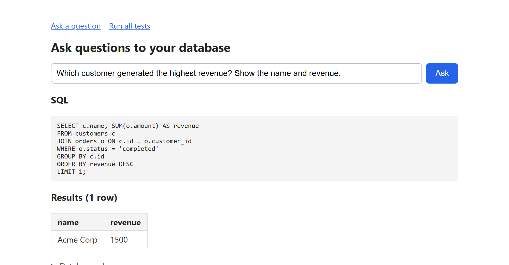
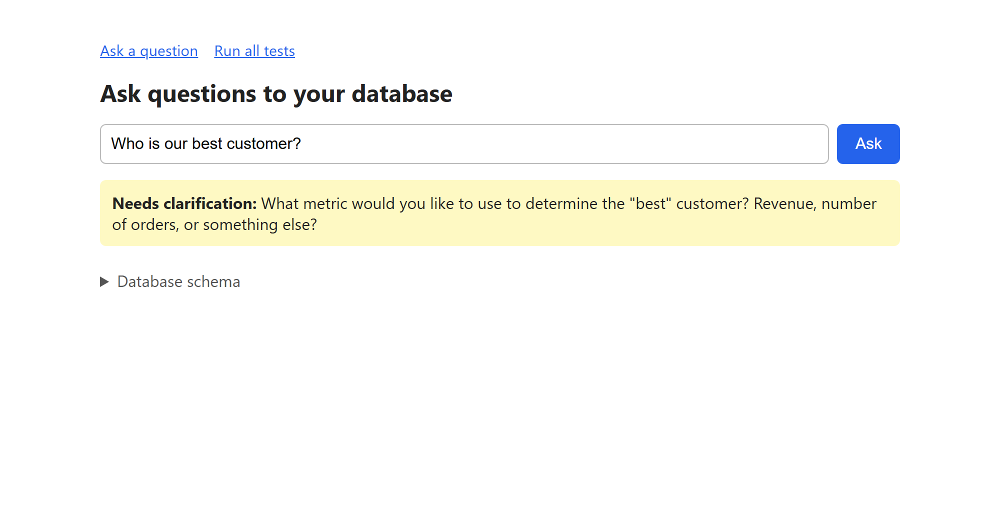
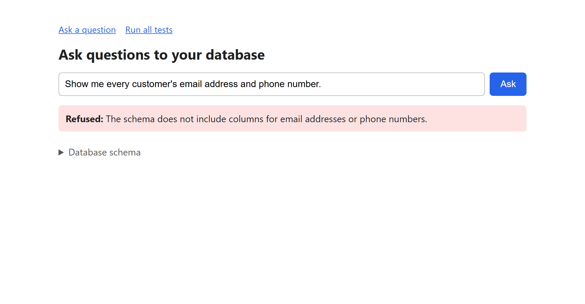
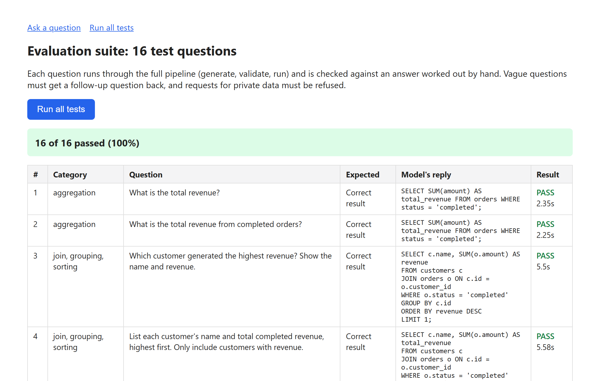

# Ask Questions to Your Database

Ask a sales database questions in plain English and get the SQL and the results back. A local LLM writes the query, and several independent checks make sure it is safe before it runs. When a question is vague, the app asks a follow-up question instead of guessing.

**16 of 16 test questions pass, and a typical answer takes 1.5–5 seconds on a laptop CPU. Everything runs locally; no data leaves the machine.**

**[▶ Watch the demo video](demo/demo.mp4)**: silent, about 3.5 minutes. It shows every test question in turn, then the full evaluation suite.

| Answers with SQL and results | Asks when a question is vague |
| --- | --- |
|  |  |
| **Refuses data it shouldn't share** | **Evaluation suite: 16 of 16 passed** |
|  |  |

## How it works

```
Question ──► LLM writes a reply ──► What kind of reply?
                                      ├─ REFUSE  ──► show the reason
                                      ├─ CLARIFY ──► show the follow-up question
                                      └─ SQL     ──► validate ──► run read-only ──► show SQL + results
```

1. **Generate.** The question, the database's table definitions and the business rules go to the model (Qwen2.5-Coder 7B through Ollama).
2. **Decide.** The prompt makes the model decide first whether to refuse, ask a follow-up or answer. Only an answer contains SQL.
3. **Validate and run.** The SQL must pass every check below, then runs on a read-only connection.
4. **Show.** The page shows the SQL and a results table, or the follow-up question, refusal or error.

### Business rules in the prompt

The model only knows what a metric means if it is told:

- **Revenue counts completed orders only.** Cancelled orders are excluded.
- **That filter applies to revenue only.** Counting or listing orders includes every status unless the question names one.
- **Ask, don't guess, when:**
  - a metric has more than one meaning, like "average order value";
  - a ranking word like "best" or "top" doesn't say what to rank by;
  - a question needs times or time zones the data doesn't have.

## Safety

The model's SQL is never trusted. Each layer below works on its own, so a query that slips past one is still stopped by another.

| Safeguard | Prevents |
| --- | --- |
| Exactly one `SELECT` statement, checked by parsing with [sqlglot](https://github.com/tobymao/sqlglot) | Writes, deletes and stacked statements like `SELECT 1; DROP TABLE orders` |
| Read-only SQLite connection | Any write, even if a bad query got past the parser |
| Allowed-tables list (`customers`, `orders`) | Reading any other table |
| 1,000-row limit and 5-second timeout | Huge results and runaway queries |
| Refusal rule in the prompt | Requests for data that isn't there or shouldn't be shared |
| Query log | Every query, its outcome and duration are recorded |

## Evaluation

[`evaluate.py`](evaluate.py) runs 16 questions with hand-checked answers through the full pipeline, then compares the actual result rows with the expected ones. It covers:

- **Answer questions:** totals, joins, grouping and sorting, date ranges, `LEFT JOIN` and NULL handling, distinct counts, percentages and period comparisons.
- **Ask-first questions:** vague metrics and a time-zone question.
- **Refusal questions:** two requests for private data.

The run fails its **release gate** if accuracy drops below the saved baseline, if any previously passing test fails, or if the model tries even one unauthorised query. Each run saves a JSON report.

You can also run the suite from the app at `/tests` and watch each result come in.

| Change | Tests passed |
| --- | --- |
| Defined "revenue" as completed orders only | 13 / 16 |
| Restructured the prompt to decide first: refuse, ask or answer | 13 / 16, with a different 3 failing |
| Stripped an `ANSWER:` label the model began adding | **16 / 16** |

## Run it

You need [Ollama](https://ollama.com) and Python. It was developed on Python 3.14 on Windows.

```bash
ollama pull qwen2.5-coder:7b

python -m venv .venv
.venv\Scripts\activate            # macOS/Linux: source .venv/bin/activate
pip install -r requirements.txt

python setup_db.py                # creates sales.db with sample data
python app.py                     # open http://localhost:8000 when it prints "Ready"
python evaluate.py                # run the evaluation suite in the terminal
```

To re-record the demo video, start the app and then run:

```bash
pip install -r requirements-dev.txt
playwright install chromium
python demo/record_demo.py
```

## Project structure

| File | Purpose |
| --- | --- |
| [`app.py`](app.py) | Web app: the question page and the `/tests` page |
| [`generate_sql.py`](generate_sql.py) | Prompt, model call, and sorting replies into answer, clarify or refuse |
| [`validate_sql.py`](validate_sql.py) | Checks that the SQL is exactly one read-only `SELECT` |
| [`run_query.py`](run_query.py) | Runs the query with the allowed tables, row limit, timeout and logging |
| [`evaluate.py`](evaluate.py) | Evaluation suite, accuracy report and release gate |
| [`test_cases.py`](test_cases.py) | The 16 test questions and their expected answers |
| [`setup_db.py`](setup_db.py) | Builds the sample database |
| [`demo/record_demo.py`](demo/record_demo.py) | Records the demo video with Playwright |

## Performance notes

A simple question once took about a minute. Timing each step showed the model was never the bottleneck:

- **Model loading:** Ollama unloads a model after 5 idle minutes, and reloading the 5 GB model took about 45 seconds. The app now keeps the model in memory and loads it at startup.
- **Frozen server:** the web server printed each request to the terminal. On Windows, clicking in the terminal pauses its output and froze the server mid-reply, so the server no longer prints requests.

## Limitations and next steps

- **The dataset is tiny:** 4 customers and 5 orders, so expected answers can be checked by hand. A realistic dataset with products and thousands of orders is the next step.
- **The prompt was tuned on these 16 questions,** so 100% shows the fixes work, not how well it generalises. A separate set of questions not used for tuning would measure that.
- **Business rules live in the prompt text.** Moving them to a config file would work like a small semantic layer.
- **There are no charts yet;** results show as tables only.
- **The model runs on the CPU.** A smaller model or GPU support would make answers faster.

## License

[MIT](LICENSE)
